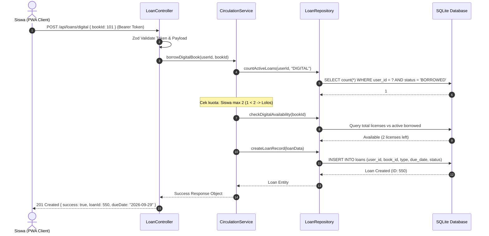
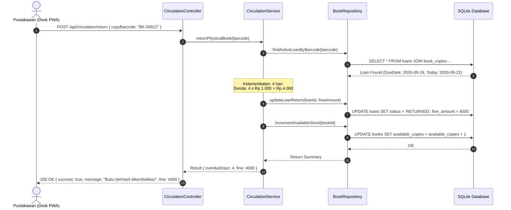
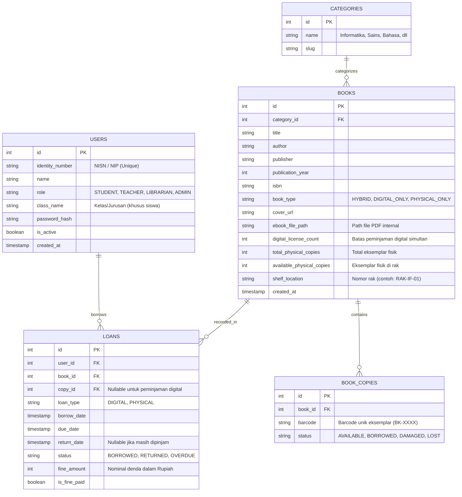

# System Architecture - Pustaka Sekolah PWA
**Project Name:** Pustaka Sekolah PWA (Hybrid Digital & Physical School Library)  
**Version:** 1.0.0  
**Pattern:** Modular Monolith (Clean Layered Architecture: `Controller -> Service -> Repository`)  

---

## 1. Overview & Pattern

### 1.1 Core Pattern
Aplikasi dirancang menggunakan pola **Modular Monolith** dengan pemisahan lapisan tanggung jawab yang ketat (*Strict Layer Decoupling*):
* **Presentation / PWA Layer (Client):** Single Page Application reaktif dengan Service Worker (PWA) untuk caching offline dan canvas rendering untuk pembacaan e-book PDF.
* **API / Controller Layer (HTTP):** *Thin Controllers* yang hanya bertugas melakukan validasi payload request (menggunakan Zod) dan memanggil Service Layer.
* **Service Layer (Domain Logic):** Pusat seluruh aturan bisnis perpustakaan (kalkulasi jatuh tempo, validasi kuota peminjaman, aturan perpanjangan, penghitungan denda, dan revokasi akses e-book).
* **Repository / Data Access Layer:** Bertanggung jawab penuh terhadap eksekusi query ke database melalui Drizzle ORM. Controller dilarang keras memanggil Repository atau database secara langsung.

### 1.2 Monolith vs Microservices
* **Keputusan:** **Modular Monolith**.
* **Rasional:** Untuk lingkungan perpustakaan sekolah dengan skala pengguna ratusan hingga beberapa ribu siswa, arsitektur Microservices akan memperkenalkan *over-engineering* dan biaya operasional jaringan yang tidak rasional. Modular Monolith menyatukan kemudahan *single-command deployment* di server sekolah dengan keterpisahan kode (*separation of concerns*) yang bersih.

### 1.3 Scaling & Offline Strategy
* **Read-Heavy Optimization:** Katalog buku dan metadata di-cache pada browser client melalui HTTP caching dan IndexedDB.
* **Offline PWA Resilience:** Service Worker melakukan precache terhadap seluruh static assets (HTML, JS, CSS, Icons), sedangkan file PDF e-book yang sedang dipinjam disimpan ke IndexedDB terenkripsi lokal untuk dibaca tanpa jaringan internet.

---

## 2. Tech Stack

| Layer | Technology | Justifikasi Teknis |
| :--- | :--- | :--- |
| **Frontend / PWA Client** | React 18 + Vite + TypeScript + Tailwind CSS | Fast HMR, bundle size kecil, ekosistem PWA matang melalui `@vite-pwa/vite-plugin-pwa` (Workbox). |
| **E-Book Engine** | PDF.js (Mozilla) + HTML5 Canvas | Standar industri rendering PDF berbasis browser tanpa dependensi plugin eksternal; mendukung injeksi watermark dinamis di layer canvas. |
| **Backend API** | Node.js + Express / Hono + TypeScript | *High throughput*, penanganan streaming file PDF yang efisien, dan dukungan TypeScript end-to-end. |
| **Database & ORM** | SQLite (`better-sqlite3`) + Drizzle ORM | Database embedded tanpa konfigurasi rumit, performa query super cepat (< 1ms), backup mudah (hanya 1 file `pustaka.db`), ideal untuk server lokal sekolah. |
| **Validation** | Zod | Schema-first type-safe validation untuk seluruh request payload dan environment variables. |
| **Authentication** | JWT (JSON Web Tokens) + Password Hashing (bcrypt) | Token terenkripsi dengan masa berlaku terkontrol dan RBAC (*Role-Based Access Control*). |
| **Testing** | Vitest + Supertest | Runner unit test super cepat yang kompatibel penuh dengan pipeline Vite/ESM. |

---

## 3. Data Flow & Sequence Diagram

### 3.1 Alur Peminjaman E-Book Digital


### 3.2 Alur Meja Sirkulasi Buku Fisik & Pengembalian (Pustakawan)


---

## 4. Database Schema Specification (Drizzle ORM)



---

## 5. Directory & Folder Layout (Modular Clean Architecture)

Sesuai `skills/architecture/layered-architecture`:
```
pustaka-sekolah-pwa/
├── .astesia/                         # Astesia context, state, and pipeline artifacts
│   ├── astesia-state.json
│   ├── brd.md
│   ├── design-system.md
│   └── architecture.md
├── uploads/                          # Direktori penyimpanan privat file e-book PDF
│   └── ebooks/
├── src/
│   ├── client/                       # Frontend PWA (React + Tailwind + Vite)
│   │   ├── assets/
│   │   ├── components/
│   │   │   ├── common/               # Button, Input, Modal, Badge
│   │   │   ├── catalog/              # BookCard, BookGrid, SearchFilter
│   │   │   ├── reader/               # PDFViewer, WatermarkOverlay, ReaderControls
│   │   │   ├── circulation/          # BarcodeScanner, LoanTable, FineModal
│   │   │   └── pwa/                  # OfflineBanner, InstallPromptIOS
│   │   ├── hooks/                    # useAuth, useOfflineCatalog, usePWA
│   │   ├── pages/                    # Home, Catalog, BookDetail, MyBooks, Reader, AdminCirculation
│   │   ├── services/                 # API client wrapper
│   │   ├── styles/                   # Tailwind CSS tokens
│   │   └── main.tsx
│   ├── server/                       # Backend Clean Architecture (Node.js/Express)
│   │   ├── config/                   # Env validation (Zod), App constants
│   │   ├── db/
│   │   │   ├── schema.ts             # Drizzle ORM Table Definitions
│   │   │   ├── index.ts              # SQLite database connection pool
│   │   │   └── seed.ts               # Sample data buku informatika & akun awal
│   │   ├── controllers/              # Thin Controllers (Request -> Service -> JSON)
│   │   │   ├── auth.controller.ts
│   │   │   ├── book.controller.ts
│   │   │   ├── loan.controller.ts
│   │   │   └── circulation.controller.ts
│   │   ├── services/                 # Pure Business Logic
│   │   │   ├── auth.service.ts
│   │   │   ├── book.service.ts
│   │   │   ├── loan.service.ts
│   │   │   └── circulation.service.ts
│   │   ├── repositories/             # Data Access Layer (Drizzle Queries)
│   │   │   ├── user.repository.ts
│   │   │   ├── book.repository.ts
│   │   │   └── loan.repository.ts
│   │   ├── middleware/               # Auth, RBAC, Error Handler, Rate Limiting
│   │   └── app.ts                    # Express app definition & route mapping
│   └── shared/                       # Shared Types & Zod Schemas (Contract)
│       ├── types/
│       └── schemas/
├── tests/                            # Unit & Integration Tests (Vitest)
│   ├── unit/
│   └── integration/
├── package.json
├── tsconfig.json
├── vite.config.ts
└── tailwind.config.js
```

---

## 6. Minimalist Execution Strategy (Ponytail Protocol)

* **Dependensi yang Ditolak (Anti-Bloat):**
  - Menolak *Heavy ORMs* seperti TypeORM/Prisma (terlalu banyak file `node_modules` dan overhead kompilasi) -> Menggunakan **Drizzle ORM** yang sangat tipis dan zero-runtime-overhead.
  - Menolak *Heavy DRM frameworks* berbayar -> Menggunakan **In-App PDF Canvas Watermark** yang 100% native browser tanpa biaya lisensi.
  - Menolak *Redux Toolkit* -> Menggunakan state management native React context / lightweight store.
* **Native / Stdlib yang Digunakan:**
  - `crypto.subtle` / native Node.js `crypto` untuk hashing dan token signing.
  - Native HTML5 Canvas 2D API untuk rendering watermark.
  - `localStorage` dan `IndexedDB` standar browser untuk caching offline.

---

## 7. Architecture Decision Records (ADR)

### ADR 001: SQLite (`better-sqlite3`) sebagai Mesin Database Utama
* **Konteks:** Perpustakaan sekolah membutuhkan sistem yang mandiri, mudah di-backup, dan tidak memerlukan tim DevOps khusus untuk maintenance server DB.
* **Keputusan:** Menggunakan SQLite dengan driver `better-sqlite3` dan WAL (Write-Ahead Logging) mode.
* **Konsekuensi:** Performa baca luar biasa cepat (< 1ms). Backup data semudah menyalin satu file `pustaka.db`. Skalabilitas mencukupi hingga 50.000 buku dan ribuan transaksi harian sekolah.

### ADR 002: In-App PDF Canvas Rendering dengan Dynamic Watermark
* **Konteks:** Menghindari pembajakan atau penyebaran bebas file e-book sekolah oleh siswa ke luar lingkungan sekolah.
* **Keputusan:** Dokumen PDF dibaca secara eksklusif menggunakan viewer in-app berbasis canvas. Setiap halaman di-overlay watermark transparan berisi Nama Lengkap dan NISN peminjam.
* **Konsekuensi:** Siswa tidak memiliki akses ke URL langsung file `.pdf`. Jika siswa melakukan screenshot, identitas pemilik akun langsung terpampang pada gambar hasil tangkapan layar.

### ADR 003: PWA Service Worker Cache Strategy (Stale-While-Revalidate + Cache-First)
* **Konteks:** Memenuhi kebutuhan akses multi-platform (Android/iOS) dan dapat membaca buku saat perangkat offline.
* **Keputusan:**
  - Asset statis aplikasi (UI, JS, CSS, Font) menggunakan strategi **Cache-First**.
  - Metadata katalog buku menggunakan strategi **Stale-While-Revalidate**.
  - Dokumen e-book yang dipinjam disimpan dalam **IndexedDB Blob Storage** dengan verifikasi jatuh tempo saat aplikasi kembali online.
