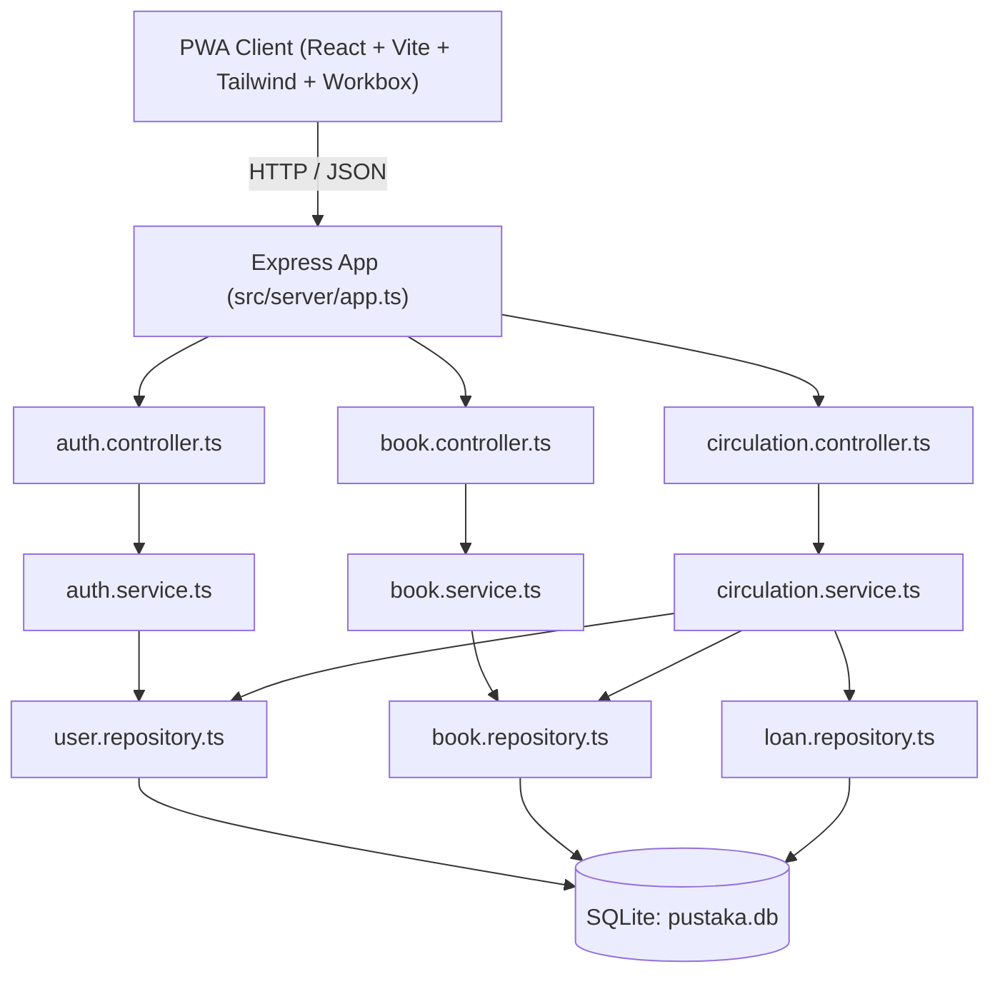

# System Map - Pustaka Sekolah PWA
**Project Name:** Pustaka Sekolah PWA  
**Updated:** 2026-10-11T21:48:00+08:00  
**Status:** In-Sync  

---

## 1. Architecture Topology

---

## 2. Directory Navigation & Trace-by-Function

| Layer | File Path | Main Exports / Key Functions |
| :--- | :--- | :--- |
| **PWA Presentation** | `src/client/App.tsx` | Root layout, tab routing (`catalog`, `my-books`, `circulation`, `users`, `profile`). |
| | `src/client/components/admin/SuperAdminPanel.tsx` | Panel Superadmin (`ADMIN`): pembuatan akun multi-peran, manajemen daftar pengguna, toggle status aktif/nonaktif, reset password, dan impor CSV. |
| | `src/client/pages/LoginPage.tsx` | Modal autentikasi dua tab: Masuk Akun & Pendaftaran Mandiri (`STUDENT` / `TEACHER`). |
| | `src/client/pages/MyBooksPage.tsx` | Rak buku pemustaka: pinjaman aktif, pengembalian mandiri buku fisik seketika (`returnPhysicalBookSelf`) & e-book, tiket reservasi, riwayat, dan berkas luring. |
| | `src/client/pages/CatalogPage.tsx` | Katalog buku dengan pemisahan status pinjam digital & fisik (`borrowedDigitalIds` vs `borrowedPhysicalIds`). |
| | `src/client/components/reader/PDFReader.tsx` | In-app canvas PDF reader with dynamic student watermark (NISN + Nama) & Sepia/Dark themes. |
| | `src/client/components/circulation/CirculationDesk.tsx` | Meja sirkulasi pustakawan: check-out fisik (dengan quick member & barcode selector), klaim reservasi, pengembalian 1-klik, dan kalkulasi denda otomatis. |
| | `src/client/components/pwa/OfflineBanner.tsx` | Realtime network status & offline notice. |
| | `src/client/components/pwa/InstallPromptIOS.tsx` | Interactive 'Add to Home Screen' modal for iOS Safari. |
| | `src/client/components/catalog/BookCard.tsx` | Hybrid format badge (`[E-Book]`, `[Fisik]`, `[Hybrid]`), tombol ganda `"Pinjam E-Book"` & `"Pinjam Fisik"`, stock status, shelf locator. |
| | `src/client/components/catalog/BookDetailModal.tsx` | Modal detail buku dengan stiker QR Code nyata (`QrCodeDisplay`), pemilih barcode eksemplar fisik, tombol `"Pinjam Buku Fisik"`, `"Reservasi (Tiket 24 Jam)"`, dan `"Pinjam E-Book"`. |
| | `src/client/components/common/QrCodeDisplay.tsx` | Generator stiker QR Code nyata (`qrcode`) beserta fitur unduh PNG untuk eksemplar buku fisik (`BK-...`) dan tiket reservasi (`RSV-...`). |
| | `src/client/components/circulation/BarcodeScannerModal.tsx` | Pemindai QR Code & Barcode 1D lintas-peramban berbasis `html5-qrcode` (kamera live WebRTC + pemindai file gambar PNG/JPG). |
| | `src/client/hooks/useAuth.tsx` | Reactive authentication context (`login`, `signup`, `logout`) & user role management. |
| | `src/client/services/api.ts` | Type-safe REST API client wrapper. |
| **Controllers (HTTP)** | `src/server/controllers/auth.controller.ts` | `POST /login`, `POST /signup`, `GET /me`, `GET /users`, `POST /register`, `PATCH /users/:id/status`, `PATCH /users/:id/password`, `POST /import-csv`. |
| | `src/server/controllers/book.controller.ts` | `GET /categories`, `GET /`, `GET /:id`, `POST /`, `POST /upload-cover`, `POST /upload-pdf`, `GET /:id/stream-pdf`. |
| | `src/server/controllers/circulation.controller.ts` | `POST /digital/borrow`, `POST /digital/return`, `POST /physical/borrow-self`, `POST /physical/return-self`, `POST /physical/reserve`, `POST /physical/claim`, `POST /physical/cancel-reserve`, `POST /physical/renew`, `POST /physical/checkout`, `POST /physical/return`, `GET /my-loans`, `GET /all`. |
| **Services (Business)** | `src/server/services/auth.service.ts` | `login()`, `selfRegister()`, `registerUser()`, `getAllUsers()`, `toggleUserStatus()`, `resetUserPassword()`, `importUsersFromCSV()`, `verifyToken()`. |
| | `src/server/services/book.service.ts` | `searchBooks()`, `getBookDetail()`, `addNewBook()`. |
| | `src/server/services/circulation.service.ts` | `borrowDigitalBook()`, `returnDigitalBook()`, `borrowPhysicalBookSelf()`, `returnPhysicalBookSelf()`, `reservePhysicalBook()`, `claimPhysicalReservation()`, `cancelPhysicalReservation()`, `renewPhysicalLoan()`, `checkOutPhysicalBook()`, `returnPhysicalBook()`. |
| **Repositories (Data)** | `src/server/repositories/user.repository.ts` | `findById()`, `findByIdentityNumber()`, `findAll()`, `create()`, `updateStatus()`, `updatePassword()`. |
| | `src/server/repositories/book.repository.ts` | `findBooks()`, `findById()`, `create()`, `findCopyByBarcode()`, `updateAvailableCopies()`. |
| | `src/server/repositories/loan.repository.ts` | `findActiveLoan()`, `countActiveUserLoans()`, `create()`, `updateReturn()`. |
| **Database DDL** | `src/server/db/schema.ts` | Drizzle ORM schema for `users`, `categories`, `books`, `bookCopies`, `loans`. |
| | `src/server/db/index.ts` | SQLite connection with WAL mode & bootstrap DDL. |
| | `src/server/db/seed.ts` | Seeder for categories, sample books (Informatika), demo users, & sample PDF. |

---

## 3. Test Coverage Map

* `tests/unit/auth.service.test.ts` (8 unit tests)
* `tests/unit/circulation.service.test.ts` (18 unit tests)
* `tests/integration/api.test.ts` (12 integration tests)
* `tests/integration/book.create.test.ts` (5 integration tests)
* Total Tests: **43 passing (100%)**
