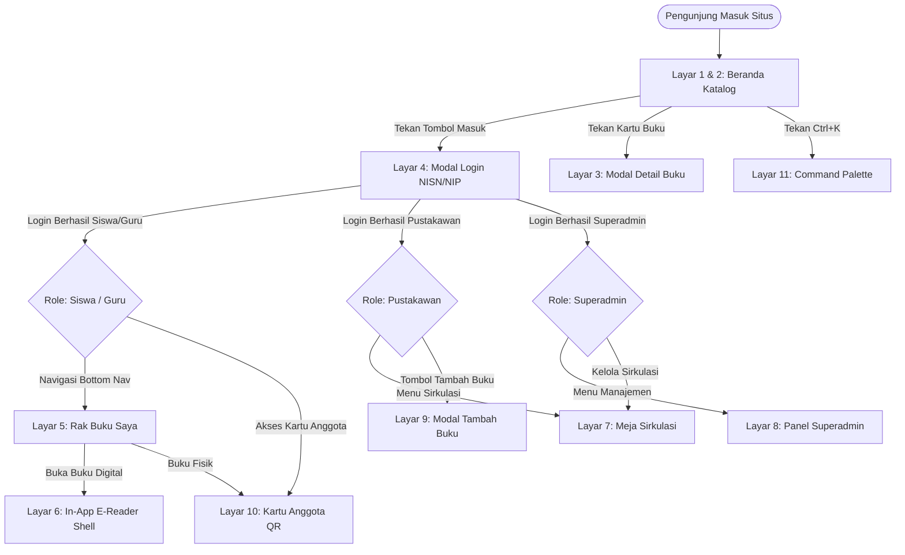

# Dokumen Spesifikasi Perancangan Antarmuka (Wireframe Blueprint)
**Nama Proyek:** Pustaka Sekolah PWA (Sistem Perpustakaan Digital & Sirkulasi Fisik Hybrid)  
**Referensi Produksi:** [https://pustaka-pwa-k0rosenseis-projects.vercel.app](https://pustaka-pwa-k0rosenseis-projects.vercel.app)  
**Layer:** Design Layer (`/astesia-design`)  
**Status:** Disetujui untuk Implementasi Rekayasa Perangkat Lunak  

---

## 1. Peta Navigasi Antarmuka (Site Map & User Flow)

Berikut adalah diagram alur navigasi pengguna (*User Journey*) yang menghubungkan seluruh antarmuka sistem berdasarkan peran otentikasi:

---

## 2. Katalog Lengkap Berkas Gambar Wireframe (Format JPG)

Semua diagram skematis rancangan antarmuka telah digenerate dalam format **JPG** (standar *low-fidelity line-art* rekayasa perangkat lunak):

| No | Berkas Gambar Wireframe (JPG) | Peran Target | Deskripsi Antarmuka |
| :---: | :--- | :--- | :--- |
| **01** | [`wireframe_01_desktop_katalog.jpg`](file:///D:/Workspaces/pustaka-sekolah-pwa/docs/wireframes/wireframe_01_desktop_katalog.jpg) | Siswa, Guru, Umum | Beranda Desktop (Navbar, Spotlight Hero, Filter Kategori, Grid 4-Kolom). |
| **02** | [`wireframe_02_mobile_katalog.jpg`](file:///D:/Workspaces/pustaka-sekolah-pwa/docs/wireframes/wireframe_02_mobile_katalog.jpg) | Siswa, Guru | Beranda Smartphone PWA (Header, Pencarian, Grid 2-Kolom, Bottom Nav). |
| **03** | [`wireframe_03_modal_detail_buku.jpg`](file:///D:/Workspaces/pustaka-sekolah-pwa/docs/wireframes/wireframe_03_modal_detail_buku.jpg) | Semua Role | Dialog detail buku, metadata rak, kuota e-book, dan aksi peminjaman. |
| **04** | [`wireframe_04_modal_login.jpg`](file:///D:/Workspaces/pustaka-sekolah-pwa/docs/wireframes/wireframe_04_modal_login.jpg) | Pengguna Belum Login | Dialog autentikasi NISN/NIP siswa & guru, password, dan registrasi mandiri. |
| **05** | [`wireframe_05_rak_saya.jpg`](file:///D:/Workspaces/pustaka-sekolah-pwa/docs/wireframes/wireframe_05_rak_saya.jpg) | Siswa, Guru | Pemantau pinjaman aktif, status cache luring (IndexedDB), dan tombol QR. |
| **06** | [`wireframe_06_reader_ebook.jpg`](file:///D:/Workspaces/pustaka-sekolah-pwa/docs/wireframes/wireframe_06_reader_ebook.jpg) | Siswa, Guru | Shell pembaca PDF dengan watermark dinamis anti-pembajakan (45°). |
| **07** | [`wireframe_07_meja_sirkulasi.jpg`](file:///D:/Workspaces/pustaka-sekolah-pwa/docs/wireframes/wireframe_07_meja_sirkulasi.jpg) | Pustakawan | Meja Sirkulasi: Panel scanner NISN & barcode, tabel transaksi, kalkulator denda. |
| **08** | [`wireframe_08_superadmin_panel.jpg`](file:///D:/Workspaces/pustaka-sekolah-pwa/docs/wireframes/wireframe_08_superadmin_panel.jpg) | Superadmin | Pusat kendali master pengguna, reset password, aktivasi status, impor CSV. |
| **09** | [`wireframe_09_modal_tambah_buku.jpg`](file:///D:/Workspaces/pustaka-sekolah-pwa/docs/wireframes/wireframe_09_modal_tambah_buku.jpg) | Pustakawan, Admin | Form input koleksi buku fisik, upload dokumen PDF e-book, dan foto cover. |
| **10** | [`wireframe_10_kartu_anggota_qr.jpg`](file:///D:/Workspaces/pustaka-sekolah-pwa/docs/wireframes/wireframe_10_kartu_anggota_qr.jpg) | Siswa, Guru | Kartu anggota perpustakaan digital virtual dengan kode QR siap-scan. |
| **11** | [`wireframe_11_command_palette.jpg`](file:///D:/Workspaces/pustaka-sekolah-pwa/docs/wireframes/wireframe_11_command_palette.jpg) | Semua Role | Global quick search modal (`Cmd+K` / `Ctrl+K`) navigasi dan pencarian instan. |

---

## 3. Tabel Spesifikasi & Fungsi Kontrol Elemen Antarmuka

Berikut adalah tabel rincian fungsi kontrol antarmuka (*UI Control Specifications*) untuk setiap layar:

### 3.1 Layar 1 & 2: Beranda & Katalog Buku (Desktop & Mobile)

| No | Kode Elemen | Nama Komponen | Tipe Kontrol | Fungsi & Keterangan Aksi |
| :---: | :--- | :--- | :--- | :--- |
| 1 | `NAV-01` | Logo Pustaka | Image / Text Link | Mengarahkan pengguna kembali ke halaman katalog utama (reset filter). |
| 2 | `NAV-02` | Navigasi Tab | Menu Link | Membuka tab aktif (`Katalog`, `Rak Saya`, `Meja Sirkulasi`, `Manajemen Akun`). |
| 3 | `NAV-03` | Tombol Masuk / Akun | Button (`btn-primary`) | Membuka modal login [`LoginPage`](file:///D:/Workspaces/pustaka-sekolah-pwa/src/client/pages/LoginPage.tsx) jika anonim, atau menu profil jika login. |
| 4 | `HERO-01`| Tombol Cari Buku | Button (`btn-outline`) | Membuka modal Command Palette (`Ctrl+K`) untuk pencarian kilat. |
| 5 | `SCH-01` | Input Pencarian | Textbox Input | Menyaring judul buku, pengarang, dan sinopsis secara real-time (debounce 200ms). |
| 6 | `FLT-01` | Filter Format Buku | Segmented Pills | Memilih jenis koleksi yang ditampilkan (`Semua`, `E-Book Digital`, `Buku Fisik`). |
| 7 | `FLT-02` | Filter Kategori | Dropdown / Chips | Menyaring buku berdasarkan taksonomi mata pelajaran (`Informatika`, `Bahasa`, dll). |
| 8 | `CARD-01`| Cover Buku (3:4) | Card / Image | Membuka dialog [`BookDetailModal`](file:///D:/Workspaces/pustaka-sekolah-pwa/src/client/components/catalog/BookDetailModal.tsx) saat ditekan. |
| 9 | `CARD-02`| Tombol Pinjam E-Book | Button (`btn-primary`) | Mengeksekusi mutasi API pinjam e-book, mengunduh cache offline, dan menambah ke rak. |
| 10| `CARD-03`| Tombol Pinjam Fisik | Button (`btn-secondary`)| Memilih eksemplar buku di rak untuk dipinjam atau direservasi jika kuota penuh. |
| 11| `BTM-01` | Bottom Navigation | App Bar | Bar navigasi bawah khusus mobile (`Katalog`, `Rak Saya`, `Kartu QR`, `Akun`). |

---

### 3.2 Layar 3: Modal Dialog Detail Buku

| No | Kode Elemen | Nama Komponen | Tipe Kontrol | Fungsi & Keterangan Aksi |
| :---: | :--- | :--- | :--- | :--- |
| 1 | `MDL-01` | Tombol Tutup [X] | Button Icon | Menutup dialog modal detail buku dan kembali ke layar katalog. |
| 2 | `MDL-02` | Badge Format & Kategori | Label Badge | Menandai apakah buku berformat `Hybrid`, `E-Book`, atau `Fisik`. |
| 3 | `MDL-03` | Salin Lokasi Rak & ISBN | Click-to-Copy Pill | Menyalin teks nomor panggil rak atau nomor ISBN ke clipboard perangkat. |
| 4 | `MDL-04` | Sinopsis Buku | Text Block | Memuat uraian ringkasan isi buku materi pelajaran. |
| 5 | `MDL-05` | Tombol Pinjam E-Book | Button | Meminjam buku digital dan langsung mengarahkan ke pembaca e-reader. |
| 6 | `MDL-06` | Tombol Pinjam / Reservasi | Button | Memilih eksemplar fisik tersedia di rak atau mengambil tiket antrean reservasi. |

---

### 3.3 Layar 4: Modal Autentikasi / Login

| No | Kode Elemen | Nama Komponen | Tipe Kontrol | Fungsi & Keterangan Aksi |
| :---: | :--- | :--- | :--- | :--- |
| 1 | `LOG-01` | Tab Mode Akun | Tab Selector | Beralih antara formulir `Masuk Akun` dan `Daftar Akun Baru`. |
| 2 | `LOG-02` | Form Input Identitas | Textbox Input | Memvalidasi format angka NISN siswa (10 digit) atau NIP guru (18 digit). |
| 3 | `LOG-03` | Form Kata Sandi | Password Input | Input kata sandi dengan proteksi masking karakter. |
| 4 | `LOG-04` | Tombol Masuk Akun | Submit Button | Mengirim kredensial ke `/api/auth/login`, menyimpan JWT, dan menyegarkan sesi. |

---

### 3.4 Layar 5: Rak Buku Saya & Status Offline

| No | Kode Elemen | Nama Komponen | Tipe Kontrol | Fungsi & Keterangan Aksi |
| :---: | :--- | :--- | :--- | :--- |
| 1 | `MYB-01` | Kartu Ringkasan Kuota | Metric Badge | Menampilkan sisa kuota pinjaman aktif (Siswa: maks 2 e-book & 3 fisik). |
| 2 | `MYB-02` | Tab Filter Pinjaman | Tab Pills | Memisahkan tampilan `E-Book Aktif`, `Buku Fisik`, dan `Riwayat Selesai`. |
| 3 | `MYB-03` | Tombol Buka E-Reader | Button (`btn-primary`) | Membuka kanvas PDF reader (bisa diakses luring tanpa kuota internet). |
| 4 | `MYB-04` | Tombol Kembalikan E-Book | Button (`btn-outline`) | Mengembalikan lisensi peminjaman digital secara sukarela lebih awal. |
| 5 | `MYB-05` | Tombol Barcode QR | Button | Memunculkan modal QR token pinjaman fisik untuk di-scan pustakawan. |

---

### 3.5 Layar 6: In-App E-Reader Shell (PDF Reader)

| No | Kode Elemen | Nama Komponen | Tipe Kontrol | Fungsi & Keterangan Aksi |
| :---: | :--- | :--- | :--- | :--- |
| 1 | `RDR-01` | Tombol Kembali | Button Icon | Menutup e-reader dan kembali ke halaman Rak Buku Saya. |
| 2 | `RDR-02` | Pilihan Tema Baca | Theme Toggle | Mengubah skema warna kanvas antara `Sepia` (kenyamanan mata), `Light`, dan `Dark`. |
| 3 | `RDR-03` | Watermark Overlay | Security Layer | Layer dinamis transparan 45° bertuliskan Nama & NISN siswa (anti-screenshot). |
| 4 | `RDR-04` | Slider Scrubber Halaman | Input Range | Menggeser posisi pembacaan secara instan ke halaman tertentu (misal hlm 1-218). |
| 5 | `RDR-05` | Navigasi Halaman | Button Previous/Next| Berpindah satu halaman ke depan atau ke belakang. |

---

### 3.6 Layar 7: Meja Sirkulasi Pustakawan

| No | Kode Elemen | Nama Komponen | Tipe Kontrol | Fungsi & Keterangan Aksi |
| :---: | :--- | :--- | :--- | :--- |
| 1 | `CIR-01` | Input Scanner NISN/NIP | Textbox / Camera | Memindai kartu anggota via barcode scanner hardware atau kamera webcam. |
| 2 | `CIR-02` | Info Anggota Siswa | Profile Box | Menampilkan riwayat peminjaman, batas kuota, dan status denda aktif siswa. |
| 3 | `CIR-03` | Input Barcode Buku | Textbox Scanner | Memindai stiker barcode eksemplar fisik buku (`BK-XXXXX`). |
| 4 | `CIR-04` | Tabel Transaksi Berjalan | Data Table | Memuat daftar buku yang dipinjam atau dikembalikan dalam sesi aktif. |
| 5 | `CIR-05` | Kalkulator Denda | Auto-Calc Box | Mengkalkulasi denda otomatis (Rp 1.000 / hari keterlambatan). |
| 6 | `CIR-06` | Tombol Selesaikan | Submit Button | Memfinalisasi transaksi, update stok eksemplar, dan mencetak struk kuitansi. |
| 7 | `CIR-07` | Tombol Ekspor CSV | Download Button | Mengunduh rekapan transaksi sirkulasi dan denda dalam format CSV. |

---

### 3.7 Layar 8: Panel Manajemen Pengguna Superadmin

| No | Kode Elemen | Nama Komponen | Tipe Kontrol | Fungsi & Keterangan Aksi |
| :---: | :--- | :--- | :--- | :--- |
| 1 | `ADM-01` | Kartu Statistik Master | Metric Cards | Ringkasan total akun terdaftar (Siswa, Guru, Pustakawan, Admin). |
| 2 | `ADM-02` | Tombol Tambah Akun | Button Dialog | Membuka modal pendaftaran akun pengguna baru secara individual. |
| 3 | `ADM-03` | Tombol Impor Massal CSV | Button Modal | Mengunggah daftar akun ratusan siswa/guru sekaligus menggunakan file CSV. |
| 4 | `ADM-04` | Tabel Data Pengguna | Data Table | Menampilkan NISN/NIP, Nama, Peran/Role, Kelas, dan Status Akun. |
| 5 | `ADM-05` | Aksi Reset Kata Sandi | Table Action | Mengatur ulang kata sandi pengguna ke password default sekolah. |
| 6 | `ADM-06` | Aksi Aktivasi/Nonaktif | Toggle Action | Memblokir akses masuk pengguna yang telah lulus atau mutasi. |

---

### 3.8 Layar 9: Modal Tambah Koleksi Buku Baru

| No | Kode Elemen | Nama Komponen | Tipe Kontrol | Fungsi & Keterangan Aksi |
| :---: | :--- | :--- | :--- | :--- |
| 1 | `BOK-01` | Pemilih Tipe Koleksi | Radio Tabs | Menentukan apakah buku berupa `Koleksi Hybrid`, `E-Book`, atau `Buku Fisik`. |
| 2 | `BOK-02` | Input Metadata Buku | Form Textbox | Mengisi Judul, Pengarang, Penerbit, Tahun Terbit, Kategori, dan ISBN. |
| 3 | `BOK-03` | Upload Cover Buku | File Upload / Cam | Mengunggah gambar cover atau mengambil foto langsung dari sampul buku fisik. |
| 4 | `BOK-04` | Upload File E-Book | PDF File Input | Mengunggah dokumen PDF buku pelajaran ke sistem penyimpanan file. |
| 5 | `BOK-05` | Input Fisik (Rak & Stok) | Form Fields | Menentukan nomor rak penyimpanan (misal `B-02`) dan kuota eksemplar fisik. |
| 6 | `BOK-06` | Tombol Simpan Buku | Submit Button | Menyimpan data buku ke basis data dan mempublikasikannya ke katalog utama. |

---

### 3.9 Layar 10: Kartu Anggota Digital & QR Siswa

| No | Kode Elemen | Nama Komponen | Tipe Kontrol | Fungsi & Keterangan Aksi |
| :---: | :--- | :--- | :--- | :--- |
| 1 | `QRC-01` | Tampilan Kartu Virtual | Virtual ID Card | Menampilkan identitas resmi siswa (Nama, NISN, Kelas, Jurusan, Foto). |
| 2 | `QRC-02` | Barcode QR Validasi | QR Code Generator | Menghasilkan kode QR dinamis berbasis barcode identitas anggota siswa. |
| 3 | `QRC-03` | Tombol Unduh Gambar | Download Button | Mengunduh berkas stiker kartu anggota dalam format PNG berkualitas tinggi. |

---

### 3.10 Layar 11: Global Command Palette (`Cmd+K`)

| No | Kode Elemen | Nama Komponen | Tipe Kontrol | Fungsi & Keterangan Aksi |
| :---: | :--- | :--- | :--- | :--- |
| 1 | `CMD-01` | Kolom Input Perintah | Quick Search Bar | Input pencarian global dengan shortcut keyboard `Ctrl+K` atau `Cmd+K`. |
| 2 | `CMD-02` | Navigasi Halaman Cepat | Action List Group | Pintasan satu-klik untuk melompat langsung ke halaman/menu sistem. |
| 3 | `CMD-03` | Hasil Pencarian Buku | Query Result List | Menampilkan judul buku yang cocok secara instan dengan tombol aksi pinjam. |
| 4 | `CMD-04` | Pintasan Keyboard | Footer Help | Panduan tombol `[↑]` `[↓]` untuk memilih, `[ENTER]` untuk pilih, `[ESC]` tutup. |
